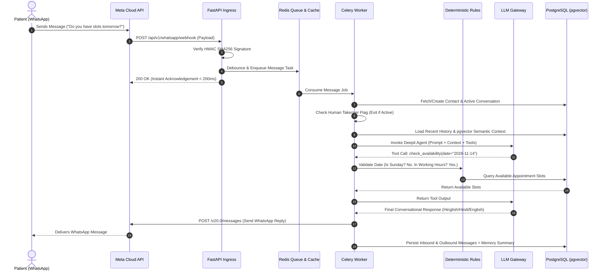

# ARCHITECTURE: WhatsApp AI Agent (Single Organization Edition)

## 1. System Vision & Paradigm
The WhatsApp AI Agent platform is a high-reliability, modular, versioned software product engineered for single-business deployment (initial reference implementation: **Physio One Clinic**). It replaces legacy fragile n8n workflows with an enterprise-grade containerized stack featuring strict boundary isolation, deterministic rule engines, multi-provider LLM gateways, and asynchronous event-driven background processing.

### The Single-Organization Rule (Core Invariant)
- **Strict Single-Tenant Architecture**: There is **no** multi-tenancy. No `organization_id` or `tenant_id` exists in the database schema.
- **Zero SaaS Billing/Switching Overhead**: Each business receives an isolated, independent deployment with its own database, cache, workers, and API keys.
- **Parametric Generalizability**: All business parameters (clinic name, doctor specialties, working hours, booking policies, AI prompts) reside in system configuration and database tables, allowing another clinic or business to deploy the identical codebase simply by changing configuration values.

---

## 2. Technology Stack & Component Responsibilities

| Layer | Technologies | Responsibilities |
| :--- | :--- | :--- |
| **Frontend** | Next.js 14+ (App Router), TypeScript, Tailwind CSS, shadcn/ui, TanStack Query | Responsive administrator dashboard, WhatsApp live inbox, appointment calendar, agent prompt configuration, campaign manager, audit & execution logs. |
| **Backend API** | Python 3.11+, FastAPI, Pydantic v2, SQLAlchemy 2.0 (Async), Alembic | High-concurrency REST endpoints, WhatsApp webhook ingress, authentication & RBAC, deterministic appointment & validation logic. |
| **Database** | PostgreSQL 16 + pgvector | Relational data persistence, ACID transactions, semantic vector embeddings, full-text audit logs. |
| **Asynchronous Engine** | Redis 7 + Celery + Celery Beat | Immediate webhook acknowledgement, message debouncing, background LLM tool execution, 3-touch follow-ups, cron-triggered campaign evaluations. |
| **AI & LLM Gateway** | Meta Muse API, OpenAI, Anthropic, Custom LLM endpoints | Provider-independent unified gateway with rate-limiting fallback chains, structured tool-calling, and streaming capabilities. |
| **Messaging Adapters**| Official Meta WhatsApp Cloud API & YCloud | Bi-directional message transport, media download/upload, voice-note transcription, read receipts. |
| **Storage** | Supabase Storage / S3-compatible object storage | Secure storage for patient media, voice recordings, campaign assets, and database backup dumps. |
| **Containerization** | Docker & Docker Compose | Containerized isolated services for Web, API, Worker, Scheduler, PostgreSQL, and Redis. |

---

## 3. High-Level System Architecture Diagram

```mermaid
flowchart TD
    subgraph External["External Clients & Providers"]
        WA[Meta WhatsApp Cloud API / YCloud]
        User[Admin / Clinic Staff Browser]
        LLM[LLM Providers: Muse / OpenAI / Anthropic]
        Storage[S3 / Supabase Storage]
    end

    subgraph Edge["Ingress & Frontend"]
        FE[Next.js 14 Dashboard\n(shadcn/ui + TanStack Query)]
        Nginx[Reverse Proxy / Ingress]
    end

    subgraph CoreBackend["FastAPI Application Services"]
        API[FastAPI REST API]
        Auth[Auth & RBAC Middleware]
        Rules[Deterministic Business Rules Engine\n(Sunday Block, Working Hours)]
        ToolReg[Secure Tool Registry]
        LLMGateway[Unified LLM Gateway]
    end

    subgraph AsyncEngine["Background Event Processing"]
        Redis[(Redis 7:\nBroker, Cache, Debounce)]
        Worker[Celery Worker:\nInbound Processor, Media Transcriber, AI Agent Loop]
        Scheduler[Celery Beat:\nFollow-up Engine, Campaign Evaluator, Health Cron]
    end

    subgraph StorageLayer["Data & Persistence"]
        DB[(PostgreSQL 16 + pgvector)]
    end

    WA -->|Inbound Webhook POST| API
    User -->|HTTPS| FE
    FE -->|REST API Calls with JWT| API
    API --> Auth
    API -->|Enqueue Event| Redis
    Redis --> Worker
    Scheduler -->|Cron Triggers| Redis
    Worker --> Rules
    Worker --> ToolReg
    Worker --> LLMGateway
    LLMGateway --> LLM
    Worker -->|Outbound Send| WA
    Worker -->|Store Media / Audio| Storage
    Worker --> DB
    API --> DB
```

---

## 4. Modular Subsystems (A through Q)

Each subsystem maintains distinct boundaries, typed contracts, and dependency injection interfaces:

1. **Module A: Dashboard (`frontend/src/`)**: 15 navigation views including Overview, Live WhatsApp Inbox, Chat History, AI Agents, Contacts/Patients, Appointments, Campaigns, Automations, Follow-ups, Knowledge Base, Tools, Analytics, Logs, Team, Settings, and Update Manager.
2. **Module B: Authentication (`backend/app/core/auth.py`)**: Argon2id password hashing, HTTP-only JWT cookies, CSRF protection, RBAC permission matrices for 5 roles (`Super Admin`, `Admin`, `Manager`, `Operator`, `Viewer`).
3. **Module C: WhatsApp Integration (`backend/app/services/whatsapp/`)**: Webhook signature verification, bi-directional message parsing, adapter pattern for Meta Cloud API and YCloud.
4. **Module D: Message Processing (`backend/app/services/messaging/`)**: Redis sliding-window debouncing (combines rapid successive messages from same user within 3-5 seconds), media download, Whisper voice-note transcription.
5. **Module E: AI Agent Runtime (`backend/app/agents/`)**: Dynamic prompt assembly, multi-turn context staging, function-calling loop, hallucination guardrails, and graceful fallback chains.
6. **Module F: LLM Provider Gateway (`backend/app/services/llm/`)**: Uniform abstraction supporting Meta Muse, OpenAI, Anthropic, and local endpoints with automatic quota-exhaustion fallback.
7. **Module G: Conversation Memory (`backend/app/services/memory/`)**: Dual-tier memory (recent sliding window + asynchronous summarization) and semantic vector search via `pgvector`.
8. **Module H: Tool Registry (`backend/app/tools/`)**: Sandboxed function execution (Find/Create Patient, Check Slots, Book/Reschedule/Cancel Appointment, Knowledge Search, Human Handoff).
9. **Module I: Appointment Management (`backend/app/services/appointments/`)**: Slot availability engine, ACID-compliant row locking for zero double-booking, and deterministic rules (e.g. Sunday closure).
10. **Module J: Campaign Manager (`backend/app/services/campaigns/`)**: Instagram Reel broadcasts, template personalization, audience criteria filters, delivery rate limiting, and compliance tracking.
11. **Module K: Follow-up Engine (`backend/app/services/followups/`)**: 3-touch re-engagement engine (2h, 24h, 48h) with strict pre-flight safety checks (opt-out, confirmed appointments, human takeover).
12. **Module L: Knowledge Base (`backend/app/services/knowledge/`)**: Document ingestion (PDF, DOCX, TXT), chunking, vector embedding generation, and cosine similarity retrieval.
13. **Module M: Automation Scheduler (`backend/app/workers/scheduler.py`)**: Celery Beat schedules for campaign evaluation (every 30 mins), follow-up evaluation (every 5 mins), and daily maintenance.
14. **Module N: Analytics Engine (`backend/app/services/analytics/`)**: Real-time aggregation of conversational volume, booking conversion, latency percentiles, and LLM token expenditures.
15. **Module O: Execution Logs (`backend/app/services/logging/`)**: Structured JSON audit logging of all API calls, webhook payloads, tool executions, and Celery tasks.
16. **Module P: System Settings (`backend/app/services/settings/`)**: Clinic operational configuration, working hours, blackout days, provider credentials, and clinic metadata.
17. **Module Q: Update Manager (`backend/app/services/updates/`)**: Version checking (`version.json`), automated database snapshots, migration execution, and rollback coordination.

---

## 5. Event Ingress & Webhook Lifecycle



---

## 6. Deterministic Guardrails vs. LLM Responsibilities

| Responsibility | Handled By | Rationale |
| :--- | :--- | :--- |
| **Sunday Closure Rule** | Backend Python Code (`RulesEngine`) | LLMs can hallucinate dates and accept appointments on closed days. The Python backend raises a strict `ClinicClosedException` if day of week is Sunday. |
| **Double Booking Prevention**| PostgreSQL Transaction (`SELECT FOR UPDATE`) | ACID database locking prevents race conditions when two patients request the same slot simultaneously. |
| **Follow-up Eligibility** | Deterministic Pre-flight Filter | Checks `has_opted_out == False`, `has_upcoming_appointment == False`, `operator_takeover == False` before LLM is even invoked. |
| **Campaign Window** | Celery Beat Time Window Check | Marketing messages are legally restricted to 09:00 - 21:00 IST. The scheduler strictly drops execution outside this window. |
| **Conversation Synthesis** | LLM Gateway (Deepti Receptionist) | Polite, empathetic tone in Hindi, English, and Hinglish; understanding voice transcripts; conversational intent resolution. |

---

## 7. WhatsApp Provider Subsystem (Task 5)

The WhatsApp messaging layer is decoupled through a common internal provider contract (`WhatsAppProvider`) supporting both official Meta WhatsApp Cloud API and YCloud (for existing Physio One operations):

```
                       ┌─────────────────────────┐
                       │   FastAPI Webhook /     │
                       │   Messaging Service     │
                       └────────────┬────────────┘
                                    │ (Resolves via Factory)
                                    ▼
                       ┌─────────────────────────┐
                       │    WhatsAppProvider     │
                       │   (Abstract Contract)   │
                       └────────────┬────────────┘
                                    │
               ┌────────────────────┴────────────────────┐
               ▼                                         ▼
   ┌───────────────────────┐                 ┌───────────────────────┐
   │   MetaCloudProvider   │                 │    YCloudProvider     │
   │  (Graph API v20.0)    │                 │ (Existing Operations) │
   └───────────┬───────────┘                 └───────────┬───────────┘
               │                                         │
               ▼                                         ▼
    Meta WhatsApp Cloud API                     YCloud WhatsApp API
```

### Key Architectural Invariants:
1. **Zero Multi-Tenancy**: All connection records and message streams belong exclusively to the single organization.
2. **Encrypted Credential Storage**: All sensitive credentials (`access_token`, `secret_key`) are symmetrically encrypted with Fernet (AES-128-CBC + HMAC-SHA256) at rest. Tokens are decrypted only in memory when dispatching requests or verifying webhook signatures.
3. **Dual Signature Verification**:
   - Meta: Validates `X-Hub-Signature-256` header against raw request payload via HMAC-SHA256 with Meta App Secret. Supports GET `hub.challenge` handshake.
   - YCloud: Validates `YCloud-Signature` header against raw request payload via HMAC-SHA256 with YCloud Webhook Secret.
4. **Durable Ingress & Deduplication**:
   - Every inbound webhook event is recorded in `webhook_events` with unique event ID constraint.
   - Duplicate events are immediately dropped with HTTP 200 to prevent duplicate processing.
   - Delivery status receipts (`sent`, `delivered`, `read`, `failed`) update the target message record without creating redundant message entities.


