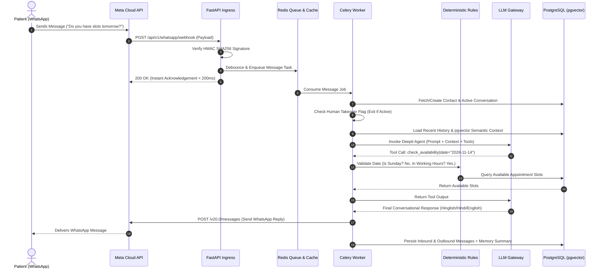
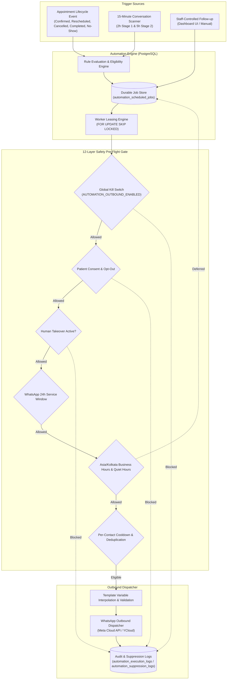
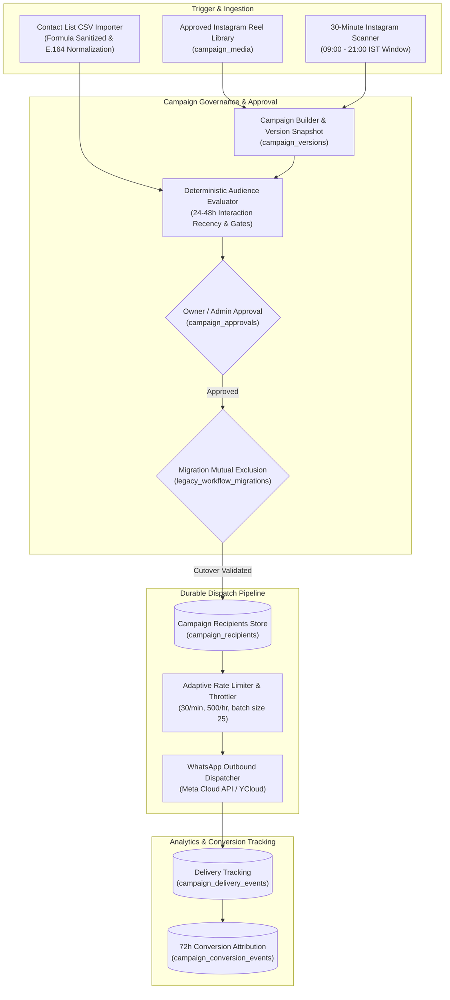

# ARCHITECTURE: WhatsApp AI Agent (Single Organization Edition)

## 1. System Vision & Paradigm
The WhatsApp AI Agent platform is a high-reliability, modular, versioned software product engineered for single-business deployment (initial reference implementation: **Physio One Clinic**). It replaces legacy fragile n8n workflows with an enterprise-grade containerized stack featuring strict boundary isolation, deterministic rule engines, multi-provider LLM gateways, and asynchronous event-driven background processing.

### The Single-Organization Rule (Core Invariant)
- **Strict Single-Tenant Architecture**: There is **no** multi-tenancy. No `organization_id` or `tenant_id` exists in the database schema.
- **Zero SaaS Billing/Switching Overhead**: Each business receives an isolated, independent deployment with its own database, cache, workers, and API keys.
- **Parametric Generalizability**: All business parameters (clinic name, doctor specialties, working hours, booking policies, AI prompts) reside in system configuration and database tables, allowing another clinic or business to deploy the identical codebase simply by changing configuration values.

---

## 2. Technology Stack & Component Responsibilities

| Layer | Technologies | Responsibilities |
| :--- | :--- | :--- |
| **Frontend** | Next.js 14+ (App Router), TypeScript, Tailwind CSS, shadcn/ui, TanStack Query | Responsive administrator dashboard, WhatsApp live inbox, appointment calendar, agent prompt configuration, campaign manager, audit & execution logs. |
| **Backend API** | Python 3.11+, FastAPI, Pydantic v2, SQLAlchemy 2.0 (Async), Alembic | High-concurrency REST endpoints, WhatsApp webhook ingress, authentication & RBAC, deterministic appointment & validation logic. |
| **Database** | PostgreSQL 16 + pgvector | Relational data persistence, ACID transactions, semantic vector embeddings, full-text audit logs. |
| **Asynchronous Engine** | Redis 7 + Celery + Celery Beat | Immediate webhook acknowledgement, message debouncing, background LLM tool execution, 3-touch follow-ups, cron-triggered campaign evaluations. |
| **AI & LLM Gateway** | Meta Muse API, OpenAI, Anthropic, Custom LLM endpoints | Provider-independent unified gateway with rate-limiting fallback chains, structured tool-calling, and streaming capabilities. |
| **Messaging Adapters**| Official Meta WhatsApp Cloud API & YCloud | Bi-directional message transport, media download/upload, voice-note transcription, read receipts. |
| **Storage** | Supabase Storage / S3-compatible object storage | Secure storage for patient media, voice recordings, campaign assets, and database backup dumps. |
| **Containerization** | Docker & Docker Compose | Containerized isolated services for Web, API, Worker, Scheduler, PostgreSQL, and Redis. |

---

## 3. High-Level System Architecture Diagram

```mermaid
flowchart TD
    subgraph External["External Clients & Providers"]
        WA[Meta WhatsApp Cloud API / YCloud]
        User[Admin / Clinic Staff Browser]
        LLM[LLM Providers: Muse / OpenAI / Anthropic]
        Storage[S3 / Supabase Storage]
    end

    subgraph Edge["Ingress & Frontend"]
        FE[Next.js 14 Dashboard\n(shadcn/ui + TanStack Query)]
        Nginx[Reverse Proxy / Ingress]
    end

    subgraph CoreBackend["FastAPI Application Services"]
        API[FastAPI REST API]
        Auth[Auth & RBAC Middleware]
        Rules[Deterministic Business Rules Engine\n(Sunday Block, Working Hours)]
        ToolReg[Secure Tool Registry]
        LLMGateway[Unified LLM Gateway]
    end

    subgraph AsyncEngine["Background Event Processing"]
        Redis[(Redis 7:\nBroker, Cache, Debounce)]
        Worker[Celery Worker:\nInbound Processor, Media Transcriber, AI Agent Loop]
        Scheduler[Celery Beat:\nFollow-up Engine, Campaign Evaluator, Health Cron]
    end

    subgraph StorageLayer["Data & Persistence"]
        DB[(PostgreSQL 16 + pgvector)]
    end

    WA -->|Inbound Webhook POST| API
    User -->|HTTPS| FE
    FE -->|REST API Calls with JWT| API
    API --> Auth
    API -->|Enqueue Event| Redis
    Redis --> Worker
    Scheduler -->|Cron Triggers| Redis
    Worker --> Rules
    Worker --> ToolReg
    Worker --> LLMGateway
    LLMGateway --> LLM
    Worker -->|Outbound Send| WA
    Worker -->|Store Media / Audio| Storage
    Worker --> DB
    API --> DB
```

---

## 4. Modular Subsystems (A through Q)

Each subsystem maintains distinct boundaries, typed contracts, and dependency injection interfaces:

1. **Module A: Dashboard (`frontend/src/`)**: 15 navigation views including Overview, Live WhatsApp Inbox, Chat History, AI Agents, Contacts/Patients, Appointments, Campaigns, Automations, Follow-ups, Knowledge Base, Tools, Analytics, Logs, Team, Settings, and Update Manager.
2. **Module B: Authentication (`backend/app/core/auth.py`)**: Argon2id password hashing, HTTP-only JWT cookies, CSRF protection, RBAC permission matrices for 5 roles (`Super Admin`, `Admin`, `Manager`, `Operator`, `Viewer`).
3. **Module C: WhatsApp Integration (`backend/app/services/whatsapp/`)**: Webhook signature verification, bi-directional message parsing, adapter pattern for Meta Cloud API and YCloud.
4. **Module D: Message Processing (`backend/app/services/messaging/`)**: Redis sliding-window debouncing (combines rapid successive messages from same user within 3-5 seconds), media download, Whisper voice-note transcription.
5. **Module E: AI Agent Runtime (`backend/app/agents/`)**: Dynamic prompt assembly, multi-turn context staging, function-calling loop, hallucination guardrails, and graceful fallback chains.
6. **Module F: LLM Provider Gateway (`backend/app/services/llm/`)**: Uniform abstraction supporting Meta Muse, OpenAI, Anthropic, and local endpoints with automatic quota-exhaustion fallback.
7. **Module G: Conversation Memory (`backend/app/services/memory/`)**: Dual-tier memory (recent sliding window + asynchronous summarization) and semantic vector search via `pgvector`.
8. **Module H: Tool Registry (`backend/app/tools/`)**: Sandboxed function execution (Find/Create Patient, Check Slots, Book/Reschedule/Cancel Appointment, Knowledge Search, Human Handoff).
9. **Module I: Appointment Management (`backend/app/services/appointments/`)**: Slot availability engine, ACID-compliant row locking for zero double-booking, and deterministic rules (e.g. Sunday closure).
10. **Module J: Campaign Manager (`backend/app/services/campaigns/`)**: Instagram Reel broadcasts, template personalization, audience criteria filters, delivery rate limiting, and compliance tracking.
11. **Module K: Follow-up Engine (`backend/app/services/followups/`)**: 3-touch re-engagement engine (2h, 24h, 48h) with strict pre-flight safety checks (opt-out, confirmed appointments, human takeover).
12. **Module L: Knowledge Base (`backend/app/services/knowledge/`)**: Document ingestion (PDF, DOCX, TXT), chunking, vector embedding generation, and cosine similarity retrieval.
13. **Module M: Automation Scheduler (`backend/app/workers/scheduler.py`)**: Celery Beat schedules for campaign evaluation (every 30 mins), follow-up evaluation (every 5 mins), and daily maintenance.
14. **Module N: Analytics Engine (`backend/app/services/analytics/`)**: Real-time aggregation of conversational volume, booking conversion, latency percentiles, and LLM token expenditures.
15. **Module O: Execution Logs (`backend/app/services/logging/`)**: Structured JSON audit logging of all API calls, webhook payloads, tool executions, and Celery tasks.
16. **Module P: System Settings (`backend/app/services/settings/`)**: Clinic operational configuration, working hours, blackout days, provider credentials, and clinic metadata.
17. **Module Q: Update Manager (`backend/app/services/updates/`)**: Version checking (`version.json`), automated database snapshots, migration execution, and rollback coordination.

---

## 5. Event Ingress & Webhook Lifecycle



---

## 6. Deterministic Guardrails vs. LLM Responsibilities

| Responsibility | Handled By | Rationale |
| :--- | :--- | :--- |
| **Sunday Closure Rule** | Backend Python Code (`RulesEngine`) | LLMs can hallucinate dates and accept appointments on closed days. The Python backend raises a strict `ClinicClosedException` if day of week is Sunday. |
| **Double Booking Prevention**| PostgreSQL Transaction (`SELECT FOR UPDATE`) | ACID database locking prevents race conditions when two patients request the same slot simultaneously. |
| **Follow-up Eligibility** | Deterministic Pre-flight Filter | Checks `has_opted_out == False`, `has_upcoming_appointment == False`, `operator_takeover == False` before LLM is even invoked. |
| **Campaign Window** | Celery Beat Time Window Check | Marketing messages are legally restricted to 09:00 - 21:00 IST. The scheduler strictly drops execution outside this window. |
| **Conversation Synthesis** | LLM Gateway (Deepti Receptionist) | Polite, empathetic tone in Hindi, English, and Hinglish; understanding voice transcripts; conversational intent resolution. |

---

## 7. WhatsApp Provider Subsystem (Task 5)

The WhatsApp messaging layer is decoupled through a common internal provider contract (`WhatsAppProvider`) supporting both official Meta WhatsApp Cloud API and YCloud (for existing Physio One operations):

```
                       ┌─────────────────────────┐
                       │   FastAPI Webhook /     │
                       │   Messaging Service     │
                       └────────────┬────────────┘
                                    │ (Resolves via Factory)
                                    ▼
                       ┌─────────────────────────┐
                       │    WhatsAppProvider     │
                       │   (Abstract Contract)   │
                       └────────────┬────────────┘
                                    │
               ┌────────────────────┴────────────────────┐
               ▼                                         ▼
   ┌───────────────────────┐                 ┌───────────────────────┐
   │   MetaCloudProvider   │                 │    YCloudProvider     │
   │  (Graph API v20.0)    │                 │ (Existing Operations) │
   └───────────┬───────────┘                 └───────────┬───────────┘
               │                                         │
               ▼                                         ▼
    Meta WhatsApp Cloud API                     YCloud WhatsApp API
```

### Key Architectural Invariants:
1. **Zero Multi-Tenancy**: All connection records and message streams belong exclusively to the single organization.
2. **Encrypted Credential Storage**: All sensitive credentials (`access_token`, `secret_key`) are symmetrically encrypted with Fernet (AES-128-CBC + HMAC-SHA256) at rest. Tokens are decrypted only in memory when dispatching requests or verifying webhook signatures.
3. **Dual Signature Verification**:
   - Meta: Validates `X-Hub-Signature-256` header against raw request payload via HMAC-SHA256 with Meta App Secret. Supports GET `hub.challenge` handshake.
   - YCloud: Validates `YCloud-Signature` header against raw request payload via HMAC-SHA256 with YCloud Webhook Secret.
4. **Durable Ingress & Deduplication**:
   - Every inbound webhook event is recorded in `webhook_events` with unique event ID constraint.
   - Duplicate events are immediately dropped with HTTP 200 to prevent duplicate processing.
   - Delivery status receipts (`sent`, `delivered`, `read`, `failed`) update the target message record without creating redundant message entities.

---

## 8. Clinical Appointments Engine & Availability Rules (Task 6)

The appointment subsystem coordinates slot generation, availability checks, state transitions, and concurrency safety:

```
  ┌────────────────────────────────────────────────────────┐
  │   Next.js Appointments UI / WhatsApp Tool Execution     │
  └───────────────────────────┬────────────────────────────┘
                              │ HTTP REST (JSON)
                              ▼
  ┌────────────────────────────────────────────────────────┐
  │      FastAPI Router (/api/v1/appointments)             │
  │  (Pydantic Validation + RBAC Permission Verification)  │
  └───────────────────────────┬────────────────────────────┘
                              │
                              ▼
  ┌────────────────────────────────────────────────────────┐
  │               AppointmentService Layer                 │
  │  - Sunday Closure Invariant (Asia/Kolkata timezone)    │
  │  - Operating Hours Validation (09:00 - 20:00 IST)      │
  │  - Slot Generation (30-min steps, 45-min duration)     │
  │  - Overlap & Conflict Detection (active bookings)      │
  │  - Concurrency Lock (asyncio lock + pg_advisory_lock)   │
  │  - Audit Logging & Chronological Lifecycle History     │
  └───────────────────────────┬────────────────────────────┘
                              │
                              ▼
  ┌────────────────────────────────────────────────────────┐
  │               PostgreSQL 16 Database                   │
  │  - appointments table with chk_appointment_no_sunday   │
  │  - btree_gist Range Exclusion Constraint               │
  │  - appointment_history chronological audit entries     │
  └────────────────────────────────────────────────────────┘
```

### Key Invariants:
1. **Authoritative Sunday Restriction**:
   - The clinic is strictly closed on Sundays.
   - Sunday prohibition is evaluated against the clinic's local timezone (`Asia/Kolkata` / UTC+05:30), not the server's local or UTC day.
   - Enforced authoritatively in `AppointmentService` for both creation and rescheduling, backed by SQL CHECK constraint `chk_appointment_no_sunday`.
2. **Double-Booking & Concurrency Strategy**:
   - Multi-tiered defense:
     a. Application-level per-slot in-process async locks (`_booking_locks`) serialize simultaneous requests in the same process.
     b. PostgreSQL transaction advisory locks (`pg_advisory_xact_lock`) serialize concurrent requests across multiple worker processes.
     c. PostgreSQL range exclusion constraint (`uq_no_overlapping_active_appointments` via `btree_gist`) provides guaranteed database-level conflict rejection for non-cancelled/non-no-show appointments.
3. **Non-Destructive Operations & Audit History**:
   - Appointments are never physically deleted. Cancellations preserve the record with a mandatory reason code and optional notes.
   - Every lifecycle transition (`created`, `rescheduled`, `cancelled`, `completed`, `no_show`, `updated`) appends an immutable entry to `appointment_history` capturing timestamps, actors, and state transitions.

---

## 8. Multi-Provider LLM Gateway & Agent Runtime Architecture (Task 7)

```
   ┌────────────────────────────────────────────────────────┐
   │             Agent Runtime & Orchestrator               │
   │  (Deterministic Budget Assembler + Tool Dispatcher)    │
   └───────────────────────────┬────────────────────────────┘
                               │ Structured Execution Request
                               ▼
   ┌────────────────────────────────────────────────────────┐
   │                     LLMGateway                         │
   │  - Provider & Model Resolution                         │
   │  - Fernet Credential Decryption                        │
   │  - Resilient Fallback Policy (No Retries on Mutations)  │
   │  - Usage & Cost Ledger (llm_usage_logs)                │
   └───────────┬───────────────────────────────┬────────────┘
               │                               │
               ▼                               ▼
   ┌───────────────────────┐       ┌───────────────────────┐
   │     MuseProvider      │       │    OpenAIProvider     │
   │  - Primary Provider   │       │  - Native Tool Calls  │
   │  - Bearer Auth        │       │  - Streaming Support  │
   │  - Strict Capability  │       │  - JSON Schema Output │
   └───────────────────────┘       └───────────────────────┘
               │                               │
               ▼                               ▼
   ┌───────────────────────┐       ┌───────────────────────┐
   │   AnthropicProvider   │       │ GenericOpenAIProvider │
   │  - Claude 3.5 Sonnet  │       │  - Local vLLM/Ollama  │
   │  - Top-Level System   │       │  - Self-Hosted LLMs   │
   │  - Tool Use Blocks    │       │  - OpenAI-Compatible  │
   └───────────────────────┘       └───────────────────────┘
```

### Key Architectural Invariants:
1. **Provider Independence**:
   - Business services and agent orchestrators never interact directly with vendor SDKs or vendor-specific JSON formats.
   - All input messages and responses conform to typed Pydantic contracts (`ChatMessage`, `LLMResponse`, `ToolCall`, `LLMUsage`).
2. **Primary Provider (Muse API)**:
   - Muse API serves as the primary clinical gateway integration.
   - Provider interface defines configurable base URL and Bearer authentication, but adheres to verified documentation invariants: `supports_tools=False` and `supports_streaming=False` are enforced by default until Meta API documentation formally exposes those schemas.
3. **Controlled Tool Calling & Security Boundary**:
   - Registered tools inherit from `BaseTool` with strict Pydantic schemas, permission categories, and timeout safeguards.
   - Clinical tools (`check_availability`, `find_patient`) integrate directly with `AppointmentService` to strictly enforce clinic invariants (Sunday closure, working hours, conflict checks).
   - PHI protection: Patient contact numbers and sensitive identifiers are masked in agent tool execution contexts.
   - Models are never granted arbitrary code execution, shell execution, raw SQL execution, or direct database mutations.
4. **Immutable Agent Versioning**:
   - Updates to agent configuration increment the agent version number and record an immutable snapshot in `ai_agent_versions`.
   - Historical execution sessions in `ai_agent_sessions` link to the exact version snapshot active at the time of execution.
5. **Token Accounting & Ledger**:
   - Every LLM invocation records input, output, and total token usage along with cost calculations in `llm_usage_logs`.

---

## Module G: pgvector Memory, Knowledge Base & Semantic Retrieval (Task 8)

```
   ┌────────────────────────────────────────────────────────┐
   │            Document Ingestion Pipeline                 │
   │  (PDF / DOCX / TXT / MD -> Magic Byte Check -> Chunk)  │
   └───────────────────────────┬────────────────────────────┘
                               │ Extracted Chunks
                               ▼
   ┌────────────────────────────────────────────────────────┐
   │             Embedding Provider Service                 │
   │  - text-embedding-3-small (1536 dim unit vectors)      │
   │  - Strict Production Guardrail (No Mock Vectors)       │
   └───────────────────────────┬────────────────────────────┘
                               │ Normalized Embeddings
                               ▼
   ┌────────────────────────────────────────────────────────┐
   │          PostgreSQL pgvector Vector Store              │
   │  - knowledge_chunks table                              │
   │  - HNSW Index (vector_cosine_ops, m=16, ef=64)        │
   │  - Cosine Distance Operator (<=>)                      │
   └───────────────────────────┬────────────────────────────┘
                               │ Vector Similarity Search
                               ▼
   ┌────────────────────────────────────────────────────────┐
   │          Semantic Retrieval & RAG Context Builder       │
   │  - Cosine similarity threshold & top-k filtering       │
   │  - Active & ready document status gate                 │
   │  - Prompt-injection defense boundary wrappers          │
   │  - SearchClinicKnowledgeTool in AgentRuntime           │
   │  - Strict Contact-Scoped Patient Memory Isolation      │
   └────────────────────────────────────────────────────────┘
```

---

## Module H: Inbound WhatsApp AI Receptionist (Deepti) Orchestration (Task 9)

```
   ┌────────────────────────────────────────────────────────┐
   │            WhatsApp Provider Webhook Ingress           │
   │      (Meta Graph API v20 / YCloud Webhook Receiver)     │
   └───────────────────────────┬────────────────────────────┘
                               │ HMAC-SHA256 Signature Verified
                               ▼
   ┌────────────────────────────────────────────────────────┐
   │       Event Deduplication & Message Persistence        │
   │  - WebhookEvent (uq_provider_event_id idempotency)     │
   │  - WhatsAppMessage (uq_provider_message_id)            │
   └───────────────────────────┬────────────────────────────┘
                               │ Enqueue Inbound Turn
                               ▼
   ┌────────────────────────────────────────────────────────┐
   │    Durable PostgreSQL Inbound Queue & Burst Debouncer  │
   │  - InboundProcessingJob (pending -> debouncing)        │
   │  - Aggregates multi-message bursts (debounce: 5s)      │
   │  - Worker Row-Level Locking (locked_by, locked_until)  │
   └───────────────────────────┬────────────────────────────┘
                               │ Debounce Window Matured
                               ▼
   ┌────────────────────────────────────────────────────────┐
   │      Inbound Conversation Orchestrator & Safety Gates   │
   │  1. Check AI Mode: disabled (Default) -> Skip          │
   │  2. Opt-Out Check: STOP/UNSUBSCRIBE -> opted_out_all   │
   │  3. Emergency Check: Emergency keywords -> Takeover     │
   │  4. Takeover/Pause Check: is_human_takeover/ai_paused   │
   │  5. Retrieve Context: Short-term turns + RAG + Memory  │
   │  6. Execute Deepti AgentRuntime (read-only tools)      │
   └───────────────────────────┬────────────────────────────┘
                               │ Response Generated
                               ▼
   ┌────────────────────────────────────────────────────────┐
   │         Response Draft & Outbound Dispatch Gate        │
   │  - Persist AIResponseDraft in database                 │
   │  - If Shadow Mode: Persist Draft for Inbox Review ONLY │
   │  - If Live Mode:                                       │
   │    * Pre-dispatch safety re-check                      │
   │    * OutboundIdempotencyKey once-and-only-once check   │
   │    * Send via Meta/YCloud Provider Adapter             │
   └────────────────────────────────────────────────────────┘
```

### Key Architectural Invariants:
1. **Disabled by Default**:
   - `ai_mode` defaults to `disabled`. The system will not generate drafts or autonomous replies without explicit administrative activation.
2. **Debounce Queueing**:
   - Burst messages within the 5-second window are aggregated into a single turn to avoid jarring, multi-message fragmented AI responses.
3. **Safety & Takeover Isolation**:
   - Opt-out immediately suppresses all messaging. Emergency triggers immediate staff takeover and emergency guidance.
   - Any manual staff interaction cancels active debounce jobs to eliminate race conditions between AI and human staff.
4. **Outbound Idempotency**:
   - Outbound dispatching is gated by `OutboundIdempotencyKey` ensuring zero duplicate patient replies.

---

## 11. Controlled AI Appointment Workflows Architecture (Task 10)

### End-to-End Workflow Flow:
```
Patient WhatsApp Message
       │
       ▼
Inbound Conversation Orchestrator
       │ (Extract Intent: Booking, Availability, Reschedule, Cancel, Status, Human)
       ▼
Appointment Intent Extractor (Asia/Kolkata NLP/Regex Rules)
       │
       ▼
Appointment Workflow Manager (AppointmentWorkflowService)
       │ (State Machine: collecting_information -> checking_availability)
       ▼
Availability Engine (AppointmentService)
       │ (Check Sunday closure, operating hours 09:00-20:00, slot durations)
       ▼
Slot Selection (select_appointment_slot)
       │ (Generate cryptographically random confirmation token & summary)
       ▼
Awaiting Patient Confirmation
       │ (Affirmative "YES" or "CONFIRM" recorded from patient)
       ▼
Policy Mode Enforcement (Mode A / Mode B / Mode C)
       │
       ├─► Mode A (Read Only - Mandatory Default): Blocks autonomous mutation.
       │
       ├─► Mode B (Staff Approval):
       │     └─► Enqueues into Human Approval Dashboard
       │     └─► Staff reviews immutable proposal version
       │     └─► Staff Approves, Rejects, or Requests Clarification
       │
       └─► Mode C (Controlled Auto-Commit - Disabled):
             └─► Evaluates automated safety criteria (verified patient, no takeover)
       │
       ▼
Authoritative Mutation (AppointmentService)
       │ (Revalidate availability + acquire concurrency lock)
       │ (Transactional execution with AppointmentOperationIdempotency deduplication)
       ▼
Persist Result & Emit Immutable Audit Event
       │
       ▼
Confirmation Response / Shadow Draft
```

### Persistent Finite State Machine (FSM):
1. `collecting_information`: Initial state while gathering patient details, date preferences, or service type.
2. `checking_availability`: Querying `AppointmentService` for valid clinic slots.
3. `awaiting_slot_selection`: Available options presented to the patient; awaiting choice.
4. `awaiting_patient_confirmation`: Specific slot selected; confirmation token issued; awaiting explicit patient "YES".
5. `awaiting_staff_approval`: Patient confirmed; proposal submitted to staff dashboard under Mode B policy.
6. `ready_to_commit`: All gates passed (or staff approved); ready for execution.
7. `committing`: Transaction underway with row locking and idempotency tracking.
8. `confirmed`: Operation successfully committed and recorded in `appointments` and `appointment_history`.
9. `cancelled`: Workflow terminated by patient rejection, staff rejection, or superseding workflow.
10. `expired`: Confirmation or workflow time budget exceeded.
11. `failed`: Booking conflict or validation error during commit.
12. `human_handoff`: Patient requested human assistance or identity verification failed.

### Controlled Agent Tool Sandbox:
- **Read-Only Tools**:
  - `check_availability`: Queries verified open slots via `AppointmentService` (rejects Sundays and invalid hours).
  - `get_patient_appointments`: Returns active and past appointments strictly scoped to the conversation's patient.
  - `get_appointment_details`: Returns details of an appointment with cross-patient access control enforcement.
- **Workflow Tools**:
  - `start_appointment_workflow`: Initializes persistent workflow state machine.
  - `select_appointment_slot`: Locks in proposed time, increments workflow version, and issues confirmation token.
  - `request_appointment_confirmation`: Formats patient confirmation summary.
  - `get_appointment_workflow_status`: Queries current FSM state and approval status.
- **Mutating Tools (Gated)**:
  - `create_appointment`: Gated by workflow state `ready_to_commit`, confirmation token, and policy mode.
  - `reschedule_appointment`: Gated by workflow state and original appointment ownership.
  - `cancel_appointment`: Gated by workflow state and explicit patient confirmation.

---

## 12. Task 11 Architecture: Durable Scheduling, Appointment Reminders & Scheduled Follow-up Automation

### Architectural Overview
Task 11 adds a high-reliability, PostgreSQL-backed durable scheduling and background execution engine for appointment reminders, inactivity re-engagement, post-appointment follow-ups, and staff-directed messaging. It guarantees that reminders and follow-ups survive application restarts, operate strictly within clinic operating hours, and remain subject to global outbound safety kill switches.



### Key Subsystems & Lifecycle:
1. **Durable Job Store (`automation_scheduled_jobs`)**:
   - Stores scheduled time in UTC with explicit timezone provenance (`Asia/Kolkata`).
   - Tracks persistent state: `scheduled` → `eligible` → `queued` → `sending` → `sent` / `delivered` / `read` / `failed` / `cancelled` / `suppressed` / `dead_letter` / `unknown_delivery`.
   - Supports transactional creation, superseding of reminders on rescheduling, and automatic cancellation upon appointment cancellation.
2. **Worker Leasing & Lease Recovery (`AutomationWorkerService`)**:
   - Concurrency-safe row leasing using `SELECT ... FOR UPDATE SKIP LOCKED` (with database-agnostic fallback for SQLite in test suites).
   - Lease timeout mechanism (default 300s): crashed or hung workers automatically forfeit locks, and expired leases are recovered cleanly.
   - Exponential retry backoff: retries failed network calls with geometric delay and automatic dead-lettering after maximum attempts (default 5).
3. **12-Layer Safety Gate (`EligibilityService`)**:
   - Global kill switch (`AUTOMATION_OUTBOUND_ENABLED=false` mandatory default).
   - Recipient consent and explicit opt-out (`opted_out_all`, `opted_out_promotions`).
   - Human takeover suppression (no automated messaging while clinic staff is actively conversing).
   - WhatsApp 24-hour customer service window enforcement (requires verified HSM template outside 24h).
   - Strict `Asia/Kolkata` operating hours (09:00–20:00 IST), quiet hours (21:00–09:00 IST), and Sunday closure deferrals.
   - Per-contact 24h rate limiting and cooldown deduplication.
4. **WhatsApp Template Engine (`TemplateService`)**:
   - Template validation ensuring templates are in `APPROVED` status before sending outside the 24-hour customer-service window.
   - Strict variable substitution with `MissingTemplateVariableError` preventing malformed or placeholder text from reaching patients.
5. **Staff Dashboard (`frontend/src/app/(dashboard)/automations/page.tsx`)**:
   - Overview metrics, kill-switch banner with confirmation modal, rule activation controls, scheduled job monitoring, job cancellation/retry actions, template preview, execution/suppression log inspection, and manual worker diagnostics.

---

## 13. Task 12 Architecture: Instagram Re-engagement, YCloud Migration & Controlled WhatsApp Campaigns

### Architectural Overview
Task 12 introduces an enterprise-grade campaign and re-engagement architecture to automate Instagram reel follow-ups, replace legacy n8n/YCloud workflows safely, and provide staff-controlled WhatsApp broadcast management with strict multi-layer approval, formula injection security, and conversion attribution.



### Key Subsystems:
1. **Instagram Reel & Media Library (`campaign_media`)**:
   - Curated repository of clinic-approved Instagram reels and multimedia assets.
   - Validates URL syntax (`instagram.com/reel/` or `instagram.com/p/`), file metadata, and staff ownership.
   - Decoupled from core messaging: reels can be attached to campaigns or referenced in templates without scraping Instagram.
2. **Deterministic Audience Evaluation & 30-Minute Scanner (`CampaignService`)**:
   - Evaluates contacts against the legacy Physio One recency specification (qualifying interaction between 24 and 48 hours ago).
   - Enforces the 09:00–21:00 IST daily permitted sending window with automatic rollover to 09:00 IST the following day.
   - 6-Layer Exclusion Gate:
     - `missing_marketing_consent`: Suppresses contacts lacking explicit opt-in.
     - `contact_opted_out_all` / `contact_opted_out_marketing`: Strictly suppresses all STOP or opt-out recipients.
     - `appointment_already_booked`: Excludes patients who already have active confirmed upcoming appointments.
     - `human_takeover_active`: Suppresses contacts currently engaged in an active human takeover conversation.
     - `already_contacted_in_campaign`: Prevents duplicate sends within the campaign.
     - `contact_cooldown_active`: Enforces per-contact campaign cooldown (default 7 days).
3. **Immutable Multi-Version Approval Queue (`campaign_versions`, `campaign_approvals`)**:
   - All campaigns default to `draft` or `audience_prepared` status.
   - Any modification to campaign copy, target rules, media attachment, or rate limits automatically invalidates existing approvals, increments `current_version`, and resets status to `draft`.
   - Immutable audit log of approvals and rejections recorded with reviewer ID, timestamp, snapshot version, and mandatory review notes for rejections. Only Owner and Admin roles hold approval authority.
4. **CSV Import with Formula Injection Protection**:
   - Sanitizes untrusted CSV inputs: values beginning with spreadsheet formula triggers (`=`, `+`, `-`, `@`) are escaped with a leading quote `'` to prevent CSV formula execution attacks upon export.
   - Normalizes all phone numbers to E.164 standard (defaulting 10-digit Indian numbers to `+91`).
   - Automatically dedupes rows within the CSV and against existing contacts.
5. **YCloud / n8n Migration State Machine (`legacy_workflow_migrations`)**:
   - Cutover States: `legacy_active` → `shadow_comparison` → `migration_ready` → `new_active` → `rolled_back`.
   - Mutual Exclusion Invariant: When in `legacy_active` or `shadow_comparison`, live outbound campaign dispatches in the new engine are strictly blocked.
   - Automated Dry-Run Engine: Simulates audience selection against active contacts, compares legacy predictions with new engine gates, and highlights targeting discrepancies.
6. **Delivery Analytics & 72-Hour Conversion Attribution**:
   - Tracks granular delivery events (`queued`, `sending`, `sent`, `delivered`, `read`, `failed`, `unknown_delivery`).
   - Computes delivery rate, read rate, failure rate, and conversion rate.
   - Automatically attributes clinic appointments confirmed within a 72-hour window following campaign delivery to the campaign record.

---

## 15. Production Readiness, Security Hardening & End-to-End Integration (Task 13)

### 15.1 Multi-Tier Worker & Scheduler Authentication Architecture
To support Google Cloud Tasks and Cloud Scheduler deployment on Cloud Run while safeguarding internal worker endpoints, privileged automation and worker routes (`/api/v1/automations/process-due`, `/api/v1/automations/scan-inactivity`, `/api/v1/campaigns/worker/run`, `/api/v1/ai-inbound/process-due`) are protected by `require_worker_auth` (`backend/app/core/worker_auth.py`):
1. **Google Cloud Tasks / Cloud Scheduler OIDC Identity Tokens**:
   - Cloud Tasks and Cloud Scheduler attach an OIDC ID token signed by Google (`iss`: `https://accounts.google.com`).
   - Validates signature, audience (`OIDC_AUDIENCE` / `CLOUD_RUN_SERVICE_URL`), expiration (`exp` with clock skew tolerance), and authorized service account email (`WORKER_SERVICE_ACCOUNT_EMAIL`).
2. **Hardened Worker Secret Token (`X-Worker-Token`)**:
   - Compares the request header against `AUTOMATION_WORKER_SECRET_TOKEN` using `hmac.compare_digest` to prevent timing attacks.
   - Enforces a minimum length requirement (16+ characters).
3. **Owner / Admin Dashboard Session**:
   - Allows authenticated clinic Owners and Administrators to manually trigger worker processing cycles or diagnostics from the UI.
   - Strictly rejects ordinary users (operator, viewer) with `403 Forbidden`, and unauthenticated requests with `401 Unauthorized`.
4. **Strict Production Enforcement**:
   - When `REQUIRE_OIDC_IN_PRODUCTION=true`, shared secret fallback is disabled, enforcing mutual service account authentication.

### 15.2 Background Worker Daemon (`app.workers.runner`)
A dedicated Python worker daemon provides continuous background processing for containerized or VM deployments:
- Orchestrates three asynchronous execution cycles:
  1. Scheduled automations & lease recovery (`AutomationWorkerService.run_worker_cycle`).
  2. Instagram re-engagement campaigns (`CampaignService.run_reengagement_cycle`).
  3. Inbound AI debounced jobs (`InboundQueueService` + `InboundOrchestrator`).
- Implements resilient signal handling (`SIGINT`/`SIGTERM`) for zero-data-loss graceful container shutdowns.
- Configurable polling interval via `WORKER_POLL_INTERVAL_SECONDS` (default: 15s).

### 15.3 Next.js Production Build Architecture
- Resolved upstream App Router compilation race conditions on Windows/Node environments via automated `scripts/patch-next.js` in `package.json` `postinstall`.
- Optimized Webpack compilation settings (`cleanDistDir: false`, `workerThreads: true`, `cpus: 1`) preventing child process IPC deadlocks.
- All 18 routes compile cleanly into static and server-rendered bundles with full TypeScript typing.


---

## Task 14 — Staging Architecture Decisions (2026-11-15)
- **No Redis/Celery:** removed from Compose; no code used it. PostgreSQL is the sole durable queue/state store — no second queue architecture.
- **Cloud execution model:** Cloud Tasks (OIDC-authenticated, deterministic task names) + Cloud Scheduler trigger existing worker HTTP endpoints; Cloud Run Jobs run `app.workers.runner --once` for bounded scans. The polling daemon is local-Compose only.
- **IaC:** `infra/staging/main.tf` (Terraform, no hardcoded project/secrets, private Cloud SQL, scale-to-zero Cloud Run). Not applied — approval gate in DEPLOYMENT.md §8.
