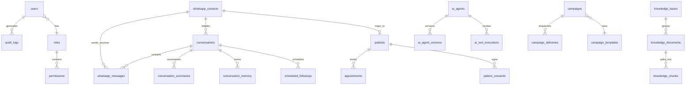

# DATABASE: Relational Schema & pgvector Design (Single Organization Edition)

## 1. Design Principles
- **Strict Single-Organization Schema**: Absolutely NO `organization_id` or `tenant_id` columns. All tables directly model the single clinic entity (Physio One).
- **Primary Keys**: Canonical UUIDv4 across all primary tables (`id UUID PRIMARY KEY DEFAULT gen_random_uuid()`).
- **Audit Columns**: Every table includes `created_at TIMESTAMPTZ NOT NULL DEFAULT now()` and `updated_at TIMESTAMPTZ NOT NULL DEFAULT now()`.
- **Foreign Keys**: Explicit foreign keys with appropriate `ON DELETE RESTRICT` or `ON DELETE CASCADE` constraints.
- **Indexing Strategy**: B-Tree indexes on foreign keys, lookup fields (phone numbers, emails, appointment start times), and composite indexes for time-window queries.
- **Vector Search**: PostgreSQL `pgvector` extension enabled for semantic memory and knowledge base chunk retrieval (`vector(1536)`).

---

## 2. Entity Relationship Diagram (High-Level)

---

## 3. Detailed Entity Definitions (30 Entities)

### A. Authentication & Access Control
1. **`roles`**:
   - `id UUID PRIMARY KEY DEFAULT gen_random_uuid()`
   - `name VARCHAR(50) UNIQUE NOT NULL` (`Super Admin`, `Administrator`, `Manager`, `Operator`, `Viewer`)
   - `description TEXT`
   - `created_at`, `updated_at TIMESTAMPTZ NOT NULL DEFAULT now()`

2. **`permissions`**:
   - `id UUID PRIMARY KEY DEFAULT gen_random_uuid()`
   - `role_id UUID NOT NULL REFERENCES roles(id) ON DELETE CASCADE`
   - `resource VARCHAR(50) NOT NULL` (`inbox`, `patients`, `appointments`, `campaigns`, `agents`, `settings`)
   - `action VARCHAR(20) NOT NULL` (`create`, `read`, `update`, `delete`, `execute`)
   - `UNIQUE(role_id, resource, action)`

3. **`users`**:
   - `id UUID PRIMARY KEY DEFAULT gen_random_uuid()`
   - `role_id UUID NOT NULL REFERENCES roles(id) ON DELETE RESTRICT`
   - `email VARCHAR(255) UNIQUE NOT NULL`
   - `password_hash VARCHAR(255) NOT NULL`
   - `full_name VARCHAR(100) NOT NULL`
   - `is_active BOOLEAN NOT NULL DEFAULT true`
   - `last_login_at TIMESTAMPTZ`
   - `created_at`, `updated_at TIMESTAMPTZ NOT NULL DEFAULT now()`

4. **`audit_logs`**:
   - `id UUID PRIMARY KEY DEFAULT gen_random_uuid()`
   - `user_id UUID REFERENCES users(id) ON DELETE SET NULL`
   - `action VARCHAR(100) NOT NULL`
   - `resource_type VARCHAR(50) NOT NULL`
   - `resource_id VARCHAR(100)`
   - `ip_address VARCHAR(45)`
   - `user_agent TEXT`
   - `payload JSONB`
   - `created_at TIMESTAMPTZ NOT NULL DEFAULT now()`

---

### B. WhatsApp Messaging & Inbound Queue
5. **`whatsapp_accounts`**:
   - `id UUID PRIMARY KEY DEFAULT gen_random_uuid()`
   - `phone_number_id VARCHAR(50) UNIQUE NOT NULL`
   - `waba_id VARCHAR(50) NOT NULL`
   - `display_phone_number VARCHAR(30) NOT NULL`
   - `access_token_encrypted TEXT NOT NULL`
   - `webhook_verify_token VARCHAR(255) NOT NULL`
   - `is_active BOOLEAN NOT NULL DEFAULT true`
   - `created_at`, `updated_at TIMESTAMPTZ NOT NULL DEFAULT now()`

6. **`whatsapp_contacts`**:
   - `id UUID PRIMARY KEY DEFAULT gen_random_uuid()`
   - `wa_id VARCHAR(50) UNIQUE NOT NULL` (E.164 phone number, e.g. `919876543210`)
   - `profile_name VARCHAR(150)`
   - `opted_out_marketing BOOLEAN NOT NULL DEFAULT false`
   - `opted_out_all BOOLEAN NOT NULL DEFAULT false`
   - `last_active_at TIMESTAMPTZ`
   - `created_at`, `updated_at TIMESTAMPTZ NOT NULL DEFAULT now()`

7. **`conversations`**:
   - `id UUID PRIMARY KEY DEFAULT gen_random_uuid()`
   - `contact_id UUID NOT NULL REFERENCES whatsapp_contacts(id) ON DELETE CASCADE`
   - `status VARCHAR(30) NOT NULL DEFAULT 'open'` (`open`, `resolved`, `escalated`, `closed`)
   - `is_human_takeover BOOLEAN NOT NULL DEFAULT false`
   - `assigned_user_id UUID REFERENCES users(id) ON DELETE SET NULL`
   - `active_agent_id UUID`
   - `last_message_at TIMESTAMPTZ`
   - `created_at`, `updated_at TIMESTAMPTZ NOT NULL DEFAULT now()`

8. **`whatsapp_messages`**:
   - `id UUID PRIMARY KEY DEFAULT gen_random_uuid()`
   - `conversation_id UUID NOT NULL REFERENCES conversations(id) ON DELETE CASCADE`
   - `contact_id UUID NOT NULL REFERENCES whatsapp_contacts(id) ON DELETE CASCADE`
   - `wa_message_id VARCHAR(100) UNIQUE NOT NULL`
   - `direction VARCHAR(10) NOT NULL` (`inbound`, `outbound`)
   - `message_type VARCHAR(20) NOT NULL` (`text`, `image`, `audio`, `video`, `document`, `interactive`, `template`)
   - `body TEXT`
   - `media_url TEXT`
   - `media_mime_type VARCHAR(50)`
   - `voice_transcription TEXT`
   - `status VARCHAR(20) NOT NULL DEFAULT 'sent'` (`received`, `sent`, `delivered`, `read`, `failed`)
   - `error_message TEXT`
   - `raw_payload JSONB`
   - `created_at TIMESTAMPTZ NOT NULL DEFAULT now()`

9. **`whatsapp_templates`**:
   - `id UUID PRIMARY KEY DEFAULT gen_random_uuid()`
   - `name VARCHAR(100) UNIQUE NOT NULL`
   - `category VARCHAR(50) NOT NULL` (`MARKETING`, `UTILITY`, `AUTHENTICATION`)
   - `language VARCHAR(10) NOT NULL DEFAULT 'en'`
   - `status VARCHAR(30) NOT NULL` (`APPROVED`, `PENDING`, `REJECTED`)
   - `header_type VARCHAR(20)` (`TEXT`, `IMAGE`, `VIDEO`, `DOCUMENT`)
   - `body_template TEXT NOT NULL`
   - `variables JSONB DEFAULT '[]'::jsonb`
   - `created_at`, `updated_at TIMESTAMPTZ NOT NULL DEFAULT now()`

10. **`message_debounce`**:
    - `id UUID PRIMARY KEY DEFAULT gen_random_uuid()`
    - `contact_wa_id VARCHAR(50) NOT NULL`
    - `message_hash VARCHAR(64) NOT NULL`
    - `received_at TIMESTAMPTZ NOT NULL DEFAULT now()`
    - `expires_at TIMESTAMPTZ NOT NULL`
    - `INDEX idx_debounce_lookup (contact_wa_id, message_hash, expires_at)`

---

### C. Patient Records & Appointments
11. **`patients`**:
    - `id UUID PRIMARY KEY DEFAULT gen_random_uuid()`
    - `contact_id UUID UNIQUE REFERENCES whatsapp_contacts(id) ON DELETE SET NULL`
    - `full_name VARCHAR(150) NOT NULL`
    - `phone_number VARCHAR(30) UNIQUE NOT NULL`
    - `email VARCHAR(255)`
    - `age INT`
    - `gender VARCHAR(20)`
    - `primary_complaint TEXT`
    - `medical_history TEXT`
    - `emergency_contact VARCHAR(100)`
    - `created_at`, `updated_at TIMESTAMPTZ NOT NULL DEFAULT now()`

12. **`patient_consents`**:
    - `id UUID PRIMARY KEY DEFAULT gen_random_uuid()`
    - `patient_id UUID NOT NULL REFERENCES patients(id) ON DELETE CASCADE`
    - `consent_type VARCHAR(50) NOT NULL` (`whatsapp_communication`, `marketing_reengagement`, `treatment_records`)
    - `is_granted BOOLEAN NOT NULL DEFAULT true`
    - `granted_at TIMESTAMPTZ NOT NULL DEFAULT now()`
    - `revoked_at TIMESTAMPTZ`

13. **`appointments`**:
    - `id UUID PRIMARY KEY DEFAULT gen_random_uuid()`
    - `patient_id UUID NOT NULL REFERENCES patients(id) ON DELETE CASCADE`
    - `practitioner_name VARCHAR(100) NOT NULL DEFAULT 'Dr. Physio One'`
    - `service_type VARCHAR(100) NOT NULL DEFAULT 'Initial Physiotherapy Assessment'`
    - `start_time TIMESTAMPTZ NOT NULL`
    - `end_time TIMESTAMPTZ NOT NULL`
    - `status VARCHAR(30) NOT NULL DEFAULT 'confirmed'` (`pending`, `confirmed`, `completed`, `cancelled`, `no_show`)
    - `cancellation_reason TEXT`
    - `booked_by VARCHAR(30) NOT NULL DEFAULT 'deepti_agent'` (`deepti_agent`, `human_staff`, `patient_online`)
    - `notes TEXT`
    - `created_at`, `updated_at TIMESTAMPTZ NOT NULL DEFAULT now()`
    - `CONSTRAINT chk_no_sunday CHECK (EXTRACT(DOW FROM start_time) != 0)`
    - `INDEX idx_appointment_time_status (start_time, end_time, status)`

---

### D. AI Agents, LLM Providers & Tools
14. **`ai_providers`**:
    - `id UUID PRIMARY KEY DEFAULT gen_random_uuid()`
    - `name VARCHAR(50) UNIQUE NOT NULL` (`muse`, `openai`, `anthropic`, `custom`)
    - `base_url VARCHAR(255) NOT NULL`
    - `api_key_encrypted TEXT NOT NULL`
    - `is_enabled BOOLEAN NOT NULL DEFAULT true`
    - `created_at`, `updated_at TIMESTAMPTZ NOT NULL DEFAULT now()`

15. **`ai_models`**:
    - `id UUID PRIMARY KEY DEFAULT gen_random_uuid()`
    - `provider_id UUID NOT NULL REFERENCES ai_providers(id) ON DELETE CASCADE`
    - `model_identifier VARCHAR(100) NOT NULL` (`gpt-4o`, `claude-3-5-sonnet`, `muse-chat-v1`)
    - `supports_tools BOOLEAN NOT NULL DEFAULT true`
    - `supports_vision BOOLEAN NOT NULL DEFAULT false`
    - `max_context_tokens INT NOT NULL DEFAULT 8192`
    - `created_at TIMESTAMPTZ NOT NULL DEFAULT now()`

16. **`ai_agents`**:
    - `id UUID PRIMARY KEY DEFAULT gen_random_uuid()`
    - `name VARCHAR(100) UNIQUE NOT NULL` (`Deepti Receptionist`, `Follow-up Copywriter`, `Campaign Personalizer`)
    - `description TEXT`
    - `primary_model_id UUID NOT NULL REFERENCES ai_models(id) ON DELETE RESTRICT`
    - `fallback_model_id UUID REFERENCES ai_models(id) ON DELETE SET NULL`
    - `system_prompt TEXT NOT NULL`
    - `temperature NUMERIC(3, 2) NOT NULL DEFAULT 0.20`
    - `max_tokens INT NOT NULL DEFAULT 1000`
    - `supported_languages JSONB NOT NULL DEFAULT '["en", "hi", "hinglish"]'::jsonb`
    - `is_active BOOLEAN NOT NULL DEFAULT true`
    - `created_at`, `updated_at TIMESTAMPTZ NOT NULL DEFAULT now()`

17. **`ai_agent_versions`**:
    - `id UUID PRIMARY KEY DEFAULT gen_random_uuid()`
    - `agent_id UUID NOT NULL REFERENCES ai_agents(id) ON DELETE CASCADE`
    - `version_number INT NOT NULL`
    - `system_prompt TEXT NOT NULL`
    - `temperature NUMERIC(3, 2) NOT NULL`
    - `changed_by_user_id UUID REFERENCES users(id)`
    - `change_summary TEXT`
    - `created_at TIMESTAMPTZ NOT NULL DEFAULT now()`
    - `UNIQUE(agent_id, version_number)`

18. **`ai_tool_definitions`**:
    - `id UUID PRIMARY KEY DEFAULT gen_random_uuid()`
    - `name VARCHAR(100) UNIQUE NOT NULL`
    - `description TEXT NOT NULL`
    - `parameters_schema JSONB NOT NULL`
    - `requires_permission VARCHAR(50) NOT NULL DEFAULT 'appointments:create'`
    - `is_enabled BOOLEAN NOT NULL DEFAULT true`
    - `created_at TIMESTAMPTZ NOT NULL DEFAULT now()`

19. **`ai_tool_executions`**:
    - `id UUID PRIMARY KEY DEFAULT gen_random_uuid()`
    - `conversation_id UUID REFERENCES conversations(id) ON DELETE CASCADE`
    - `agent_id UUID REFERENCES ai_agents(id) ON DELETE SET NULL`
    - `tool_name VARCHAR(100) NOT NULL`
    - `arguments JSONB NOT NULL`
    - `result JSONB`
    - `status VARCHAR(20) NOT NULL` (`success`, `failed`, `rejected_by_rule`)
    - `execution_duration_ms INT NOT NULL`
    - `error_message TEXT`
    - `created_at TIMESTAMPTZ NOT NULL DEFAULT now()`

---

### E. Memory & Knowledge Base (pgvector)
20. **`conversation_summaries`**:
    - `id UUID PRIMARY KEY DEFAULT gen_random_uuid()`
    - `conversation_id UUID NOT NULL REFERENCES conversations(id) ON DELETE CASCADE`
    - `summary_text TEXT NOT NULL`
    - `key_entities JSONB`
    - `last_summarized_message_id UUID REFERENCES whatsapp_messages(id)`
    - `created_at TIMESTAMPTZ NOT NULL DEFAULT now()`

21. **`conversation_memory`**:
    - `id UUID PRIMARY KEY DEFAULT gen_random_uuid()`
    - `contact_id UUID NOT NULL REFERENCES whatsapp_contacts(id) ON DELETE CASCADE`
    - `memory_type VARCHAR(50) NOT NULL` (`preference`, `clinical_note`, `appointment_preference`)
    - `content TEXT NOT NULL`
    - `embedding vector(1536)` (OpenAI/Muse compatible vector embedding)
    - `confidence_score NUMERIC(3, 2) NOT NULL DEFAULT 1.00`
    - `created_at TIMESTAMPTZ NOT NULL DEFAULT now()`
    - `INDEX idx_memory_vector ON conversation_memory USING hnsw (embedding vector_cosine_ops)`

22. **`knowledge_bases`**:
    - `id UUID PRIMARY KEY DEFAULT gen_random_uuid()`
    - `name VARCHAR(100) UNIQUE NOT NULL`
    - `description TEXT`
    - `is_active BOOLEAN NOT NULL DEFAULT true`
    - `created_at`, `updated_at TIMESTAMPTZ NOT NULL DEFAULT now()`

23. **`knowledge_documents`**:
    - `id UUID PRIMARY KEY DEFAULT gen_random_uuid()`
    - `knowledge_base_id UUID NOT NULL REFERENCES knowledge_bases(id) ON DELETE CASCADE`
    - `title VARCHAR(255) NOT NULL`
    - `file_type VARCHAR(20) NOT NULL` (`pdf`, `docx`, `txt`, `markdown`)
    - `file_url TEXT NOT NULL`
    - `chunk_count INT NOT NULL DEFAULT 0`
    - `created_at TIMESTAMPTZ NOT NULL DEFAULT now()`

24. **`knowledge_chunks`**:
    - `id UUID PRIMARY KEY DEFAULT gen_random_uuid()`
    - `document_id UUID NOT NULL REFERENCES knowledge_documents(id) ON DELETE CASCADE`
    - `chunk_index INT NOT NULL`
    - `chunk_text TEXT NOT NULL`
    - `embedding vector(1536)`
    - `created_at TIMESTAMPTZ NOT NULL DEFAULT now()`
    - `INDEX idx_knowledge_vector ON knowledge_chunks USING hnsw (embedding vector_cosine_ops)`

---

### F. Follow-ups, Campaigns & Automation
25. **`scheduled_followups`**:
    - `id UUID PRIMARY KEY DEFAULT gen_random_uuid()`
    - `contact_id UUID NOT NULL REFERENCES whatsapp_contacts(id) ON DELETE CASCADE`
    - `conversation_id UUID NOT NULL REFERENCES conversations(id) ON DELETE CASCADE`
    - `touch_stage INT NOT NULL` (1: 2h inactivity, 2: 24h sequence, 3: 48h / 5h rule)
    - `scheduled_for TIMESTAMPTZ NOT NULL`
    - `status VARCHAR(30) NOT NULL DEFAULT 'scheduled'` (`scheduled`, `sent`, `cancelled`, `suppressed`)
    - `suppression_reason VARCHAR(100)` (`opt_out`, `booked_appointment`, `human_takeover`, `outside_business_hours`)
    - `sent_message_id UUID REFERENCES whatsapp_messages(id)`
    - `created_at TIMESTAMPTZ NOT NULL DEFAULT now()`
    - `INDEX idx_followup_status_schedule (status, scheduled_for)`

26. **`campaign_templates`**:
    - `id UUID PRIMARY KEY DEFAULT gen_random_uuid()`
    - `whatsapp_template_id UUID REFERENCES whatsapp_templates(id)`
    - `name VARCHAR(100) NOT NULL`
    - `reel_url TEXT`
    - `thumbnail_url TEXT`
    - `headline VARCHAR(200)`
    - `body_template TEXT NOT NULL`
    - `created_at TIMESTAMPTZ NOT NULL DEFAULT now()`

27. **`campaigns`**:
    - `id UUID PRIMARY KEY DEFAULT gen_random_uuid()`
    - `campaign_template_id UUID NOT NULL REFERENCES campaign_templates(id)`
    - `title VARCHAR(150) NOT NULL`
    - `status VARCHAR(30) NOT NULL DEFAULT 'draft'` (`draft`, `scheduled`, `active`, `completed`, `paused`)
    - `target_audience_rules JSONB NOT NULL DEFAULT '{"interaction_window_hours": [24, 48]}'::jsonb`
    - `start_time TIMESTAMPTZ`
    - `end_time TIMESTAMPTZ`
    - `total_targeted INT NOT NULL DEFAULT 0`
    - `total_sent INT NOT NULL DEFAULT 0`
    - `total_delivered INT NOT NULL DEFAULT 0`
    - `total_replied INT NOT NULL DEFAULT 0`
    - `created_at, updated_at TIMESTAMPTZ NOT NULL DEFAULT now()`

28. **`campaign_deliveries`**:
    - `id UUID PRIMARY KEY DEFAULT gen_random_uuid()`
    - `campaign_id UUID NOT NULL REFERENCES campaigns(id) ON DELETE CASCADE`
    - `contact_id UUID NOT NULL REFERENCES whatsapp_contacts(id) ON DELETE CASCADE`
    - `status VARCHAR(30) NOT NULL DEFAULT 'pending'` (`pending`, `sent`, `delivered`, `read`, `replied`, `failed`)
    - `error_reason TEXT`
    - `sent_at TIMESTAMPTZ`
    - `created_at TIMESTAMPTZ NOT NULL DEFAULT now()`
    - `UNIQUE(campaign_id, contact_id)`

29. **`automation_rules`**:
    - `id UUID PRIMARY KEY DEFAULT gen_random_uuid()`
    - `name VARCHAR(100) UNIQUE NOT NULL`
    - `trigger_type VARCHAR(50) NOT NULL` (`conversation_inactivity`, `campaign_reengagement`, `appointment_reminder`)
    - `condition_json JSONB NOT NULL`
    - `action_type VARCHAR(50) NOT NULL`
    - `is_enabled BOOLEAN NOT NULL DEFAULT true`
    - `created_at, updated_at TIMESTAMPTZ NOT NULL DEFAULT now()`

30. **`system_settings`**:
    - `key VARCHAR(100) PRIMARY KEY`
    - `value JSONB NOT NULL`
    - `description TEXT`
    - `updated_at TIMESTAMPTZ NOT NULL DEFAULT now()`
    - *(Key examples: `clinic_profile`, `business_hours`, `blackout_weekdays`, `followup_intervals`, `installed_version`)*
