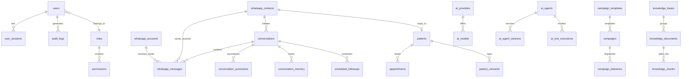

# DATABASE: Relational Schema & pgvector Design (Single Organization Edition)

## 1. Design Principles & Architecture
- **Strict Single-Organization Schema**: Absolutely NO `organization_id` or `tenant_id` columns. All tables directly model the single clinic entity (Physio One).
- **Dual WhatsApp Provider Support**: Native support for both **Meta WhatsApp Cloud API** and **YCloud**, with explicit provider identifiers, separate configuration storage, and encrypted credentials.
- **Deduplication & Replay Protection**: Unique composite constraints on `(provider, provider_message_id)` and `(provider, event_id)` preventing duplicate message processing and webhook replays.
- **Primary Keys**: Canonical UUIDv4 across all entities (`id UUID PRIMARY KEY DEFAULT gen_random_uuid()`).
- **Audit Columns**: System tables include `created_at TIMESTAMPTZ NOT NULL DEFAULT now()` and `updated_at TIMESTAMPTZ NOT NULL DEFAULT now()`.
- **Vector Search**: PostgreSQL `pgvector` extension enabled via initial migration (`vector(1536)` with HNSW cosine indexes).
- **Sunday Clinic Restriction**: Enforced authoritatively in the backend Appointment business service with database check constraints applied via Alembic migrations.

---

## 2. Implemented Database Entities (34 Tables)



### Table Breakdown by Subsystem

#### 1. Access Control & Auditing (5 tables)
1. **`roles`**: System roles (`Super Admin`, `Administrator`, `Manager`, `Operator`, `Viewer`).
2. **`permissions`**: Granular permissions mapped to roles (`uq_role_resource_action`).
3. **`users`**: Clinic staff credentials with Argon2id password hashes (`uq_users_email`).
4. **`user_sessions`**: Active staff browser sessions with token hashes and expiry timestamps.
5. **`audit_logs`**: Immutable security log of administrative actions, resource modifications, and user logins.

#### 2. WhatsApp Messaging & Inbound Queue (7 tables)
6. **`whatsapp_accounts`**: Provider accounts (Meta / YCloud) with encrypted tokens and provider-specific configurations.
7. **`whatsapp_contacts`**: WhatsApp contacts identified by E.164 phone numbers (`uq_whatsapp_contacts_wa_id`), with opt-out flags.
8. **`conversations`**: Active conversational threads with status, human takeover toggles, and AI pause states.
9. **`whatsapp_messages`**: Individual messages with `provider` ('meta' | 'ycloud'), direction, message type, transcription, and unique constraint `uq_provider_message_id`.
10. **`webhook_events`**: Deduplicated event log from webhook payloads with unique constraint `uq_provider_event_id`.
11. **`message_debounce`**: Sliding-window debouncing cache for rapid successive messages.
12. **`whatsapp_templates`**: Approved WhatsApp marketing and utility templates.

#### 3. Patient Records & Appointments (4 tables)
13. **`patients`**: Clinic patient master record linked optionally to WhatsApp contact.
14. **`patient_consents`**: Formal consent records for WhatsApp communication and marketing.
15. **`appointments`**: Bookings with practitioner, service, start/end times, duration (`duration_minutes`), timezone (`Asia/Kolkata`), booking source, staff creator/updater (`created_by_id`, `updated_by_id`), Sunday check constraint (`chk_appointment_no_sunday`), and PostgreSQL range exclusion constraint (`uq_no_overlapping_active_appointments`).
16. **`appointment_history`**: Audit event tracking and chronological lifecycle history (created, rescheduled, cancelled, completed, no_show, updated) with previous and updated start/end times, reason codes, actor details (`actor_type`, `actor_id`), and staff notes.

#### 4. AI Engine & Tool Execution (6 tables)
17. **`ai_providers`**: LLM gateway endpoints (Muse, OpenAI, Anthropic, Custom).
18. **`ai_models`**: Supported models per provider with tool/vision flags.
19. **`ai_agents`**: Configured agent personas (Deepti, Follow-up, Campaign).
20. **`ai_agent_versions`**: Historical versions of agent system prompts.
21. **`ai_tool_definitions`**: JSON-schema validated tool specifications.
22. **`ai_tool_executions`**: Execution history and audit logs of tool calls.

#### 5. Long-term Memory & Knowledge Base (5 tables)
23. **`conversation_summaries`**: Periodic summaries of conversation threads.
24. **`conversation_memory`**: Long-term semantic memory chunks with `vector(1536)` and HNSW index.
25. **`knowledge_bases`**: Document collections.
26. **`knowledge_documents`**: Uploaded clinical and policy files (PDF/DOCX).
27. **`knowledge_chunks`**: Vectorized document chunks with `vector(1536)` and HNSW index.

#### 6. Campaigns & Re-engagement (3 tables)
28. **`campaign_templates`**: Marketing templates with Instagram Reel URLs and thumbnails.
29. **`campaigns`**: Scheduled campaigns with targeting rules and delivery metrics.
30. **`campaign_deliveries`**: Recipient deliveries with eligibility flags and attempt counters (`uq_campaign_recipient`).

#### 7. Automations & Background Execution (3 tables)
31. **`scheduled_followups`**: Durable 3-touch follow-up tasks (2h, 24h, 48h) with suppression states.
32. **`automation_rules`**: Trigger-condition-action definitions.
33. **`background_jobs`**: Durable queue state for Cloud Tasks / Celery asynchronous processing.

#### 8. System Settings (1 table)
34. **`system_settings`**: Key-value JSONB settings for clinic profile, hours, and version metadata.

---

## 3. Database Migration Protocol (Alembic)

### Migration Commands
```bash
# Apply pending migrations to database
alembic upgrade head

# Generate dry-run SQL without executing
alembic upgrade head --sql

# Create a new expand-and-contract migration
alembic revision -m "add_new_feature"

# Check current revision status
alembic current
```

### Applied Migrations
- `backend/alembic/versions/001_initial_schema.py`:
  - Executes `CREATE EXTENSION IF NOT EXISTS vector;`
  - Constructs baseline 33 tables, indexes, constraints, and foreign keys.
- `backend/alembic/versions/002_appointment_history_and_rules.py`:
  - Creates `appointment_history` table with chronological lifecycle tracking.
  - Adds `duration_minutes` (default 45), `created_by_id`, and `updated_by_id` foreign keys to `appointments`.
  - Enforces `chk_appointment_no_sunday` check constraint.
  - Adds PostgreSQL `btree_gist` range exclusion constraint `uq_no_overlapping_active_appointments` preventing concurrent or overlapping active appointments.
- `backend/alembic/versions/003_ai_agent_sessions_and_usage.py`:
  - Creates `ai_agent_sessions` table tracking conversation and standalone agent execution sessions, lifecycle states, and aggregated metrics.
  - Creates `ai_agent_executions` table capturing step-level execution details, latency, model usage, tool calls, and LLM responses.
  - Creates `llm_usage_logs` table tracking prompt, completion, total token counts, estimated financial costs, and latency across providers.
  - Alters `ai_providers` adding `is_default`, `encrypted_credentials`, `default_model`, and `health_status`.
  - Alters `ai_agents` adding `fallback_model_id`, `max_execution_steps`, and `execution_timeout_seconds`.
  - Alters `ai_agent_versions` adding `max_tokens` and `allowed_tools`.
  - Alters `ai_tool_executions` adding `session_id` foreign key.
  - Total database tables expanded to 37.
- `backend/alembic/versions/004_knowledge_base_pgvector_rag.py`:
  - Ensures `vector` extension is active.
  - Adds document tracking metadata: `source_hash`, `file_type`, `file_size_bytes`, and document `version` to `knowledge_documents`.
  - Adds `chunk_metadata` (JSONB) to `knowledge_chunks`.
  - Creates pgvector HNSW cosine distance index `ix_knowledge_chunks_embedding_hnsw` on `knowledge_chunks.embedding` using `vector_cosine_ops`.
  - Creates `ai_retrieval_logs` table tracking semantic query, similarity threshold, top-k chunks, matched chunk IDs, latency ms, and session ID.
  - Alters `ai_agents` adding RAG settings: `knowledge_base_id`, `rag_enabled`, `rag_similarity_threshold`, and `rag_top_k`.
  - Total database tables expanded to 38.
- `backend/alembic/versions/005_inbound_ai_orchestration.py`:
  - Creates `inbound_processing_jobs`: durable queue tracking incoming WhatsApp messages, burst message aggregation, debounce windows, and worker locks.
  - Creates `ai_inbound_settings`: global and per-account AI orchestration configuration (`ai_mode` defaulting to `disabled`, `debounce_seconds`, `opt_out_keywords`, `emergency_keywords`).
  - Creates `conversation_handoffs`: immutable audit trail of human staff takeovers, AI pause/resume events, emergency detections, and patient opt-outs.
  - Creates `ai_response_drafts`: AI generated responses persisted during shadow mode or pre-dispatch for staff inbox inspection.
  - Creates `outbound_idempotency_keys`: strict once-and-only-once delivery tracking preventing duplicate outbound WhatsApp messages.
  - Total database tables expanded to 43.
- `backend/alembic/versions/006_appointment_ai_workflows.py`:
  - Creates `appointment_ai_workflows`: persistent workflow state machine entity tracking conversation, contact, patient, appointment, intent, workflow state, version, selected slots, collected data, proposed changes, confirmation/approval status, and expiration.
  - Creates `appointment_workflow_events`: immutable audit trail of state transitions and human staff actions with notes and version snapshots.
  - Creates `appointment_confirmations`: patient confirmation records with cryptographically random tokens, formatted summaries, and expiration timestamps.
  - Creates `appointment_approval_requests`: staff approval queue records with immutable proposal summaries and versioning preventing stale execution.
  - Creates `appointment_operation_idempotency`: transactional deduplication table guaranteeing once-and-only-once appointment mutations.
  - Creates `appointment_workflow_settings`: singleton automation policy configuration (`policy_mode` defaulting to `mode_a_read_only`, timeouts, and thresholds).
  - Total database tables expanded to 49.
- `backend/alembic/versions/007_scheduled_automation.py`:
  - Creates `automation_message_templates`: pre-approved and draft WhatsApp templates with provider, category (UTILITY/MARKETING), approval status, extracted variables, and versioning.
  - Creates `automation_scheduled_jobs`: durable PostgreSQL-backed job queue tracking scheduled execution time, lifecycle states (`scheduled`, `eligible`, `queued`, `sending`, `sent`, `delivered`, `failed`, `cancelled`, `suppressed`), worker leasing (`locked_by`, `locked_at`, `lease_expires_at`), attempt counters, and payload snapshots.
  - Creates `automation_execution_logs`: chronological event log recording state transitions, worker lease acquisitions, provider dispatches, and delivery updates.
  - Creates `automation_suppression_logs`: safety gate audit trail logging the specific suppression reason (kill switch, consent opt-out, human takeover, quiet hours, business hours, cooldown) and evaluation context.
  - Creates `automation_settings`: singleton system-level scheduling controls (`outbound_enabled` defaulting to `false`, timezone `Asia/Kolkata`, quiet hours 21:00–09:00, business hours 09:00–20:00, worker interval, and retry policies).
  - Creates `automation_contact_cooldowns`: per-contact cooldown tracking preventing duplicate sends within configured cooldown windows (default 24h).
  - Alters `automation_rules`: adds delay offsets, business hours windows, permitted days, timezone, provider, retry policy, and eligibility filters.
  - Total database tables expanded to 55.
- `backend/alembic/versions/008_campaigns_instagram_reengagement.py`:
  - Creates `campaign_media`: approved Instagram reel and multimedia library with URL validation, staff ownership, caption, tags, and active status.
  - Creates `campaign_versions`: immutable snapshot history of campaign rules, media, copy, rate limits, and batch parameters.
  - Creates `campaign_audiences`: audience evaluation cache linking campaigns to evaluated contact segments.
  - Creates `campaign_recipients`: individual recipient tracking store recording E.164 phone, lifecycle delivery status, suppression reasons, attempts, and timestamps.
  - Creates `campaign_approvals`: immutable multi-version approval audit log capturing reviewer decision, snapshot version, and mandatory review notes.
  - Creates `campaign_delivery_events`: chronological delivery event telemetry from Meta Cloud API and YCloud webhooks.
  - Creates `campaign_conversion_events`: 72-hour conversion attribution linking delivered campaign messages to confirmed clinic appointments.
  - Creates `legacy_workflow_migrations`: cutover state machine tracking migration status (`legacy_active`, `shadow_comparison`, `migration_ready`, `new_active`, `rolled_back`), dry-run discrepancies, and mutual exclusion invariants.
  - Alters `campaigns`: adds `campaign_type`, `description`, `current_version`, `is_approved`, `approved_by_id`, `approved_at`, `approved_version`, `approval_notes`, `template_name`, `template_id`, `custom_message_body`, `media_id`, rate limits, batch size, cooldown days, delivery aggregates, and error message.
  - Total database tables expanded to 63.

---

## 4. Running Database Tests
```bash
# Run the complete database and migration test suite (13 tests)
python -m pytest backend/tests/test_database.py -v
```

---

## Task 14 — PostgreSQL Verification (2026-11-15)
Static audit: Alembic chain is linear `001→008`; migrations contain exactly 63 `create_table` calls matching the expected table count; HNSW indexes (001/004) and the appointment exclusion constraint (002) are present in DDL. Live verification against a fresh disposable database is scripted in `scripts/verify_postgres.py` (pgvector, 63 tables, HNSW, exclusion/FK constraints, head=008, optional `--from-revision` upgrade-preservation check).

---

## Task 15 — Live Database Verification & Alembic Version Hardening (2026-11-17)
- **Live PostgreSQL 16 + pgvector Execution:**
  - Ran `scripts/verify_postgres.py` against isolated PostgreSQL 16 container (`physio_postgres`).
  - Verified pgvector extension active (`vector` type registered).
  - Exactly 63 tables verified and mapped.
  - HNSW vector indexes verified on `knowledge_chunks` and `conversation_memory`.
  - Exclusion constraints verified: `bdr_appointments_no_overlap` (`contype='x'`).
  - Synthetic data preserved across upgrade simulation.
- **Alembic Version Table Patch:**
  - Standard Alembic hardcodes `Column("version_num", String(32))` in `DefaultImpl.version_table_impl`.
  - Revisions `002_appointment_history_and_rules` (35 chars) and `008_campaigns_instagram_reengagement` (38 chars) exceed 32 characters, which caused `StringDataRightTruncation` on PostgreSQL.
  - Patched `backend/alembic/env.py` with `_version_table_impl` setting `String(128)` and added an online migration hook ensuring `alembic_version` table uses `VARCHAR(128)`.

---

## Task 17 Cloud SQL Architecture & Connection Sizing (2026-11-18)

- **Dedicated Migration Runner Job:**
  - In Cloud Run, database migrations are separated from the API service and executed as a dedicated Cloud Run Job `physio-staging-db-migrate`.
  - The job runs `alembic upgrade head` over the Cloud SQL Unix socket (`/cloudsql/<connection_name>`) using `POSTGRES_USER=physio_admin` and Secret Manager credentials.
  - In `alembic/env.py`, `pool.NullPool` is used during migrations to avoid retaining persistent idle connections.
- **Connection Budget & Tier Sizing Analysis:**
  - **Standard Tier (`db-custom-1-3840`):** 1 vCPU, 3.75 GB RAM, `max_connections = 100`. Peak system load across 3 API instances ($3 \times 10 = 30$), worker jobs ($1 \times 3 = 3$), migration runner (1), and admin/internal connections (5) totals 39 connections, providing 61 connections of headroom. Recommended for pgvector vector operations.
  - **Shared-Core Tier (`db-f1-micro`):** 1 shared vCPU, 0.6 GB RAM, `max_connections = 25`. If selected for cost-sensitive testing, API containers must be configured with `POSTGRES_POOL_SIZE=2` and `POSTGRES_MAX_OVERFLOW=2` ($3 \times 4 + 1 + 1 + 5 = 19 \le 25$).
  - Added programmatic validator `calculate_connection_budget` in `backend/app/core/config.py` with full unit test coverage.
- **Zero-Secret User Management:**
  - `google_sql_user.user` in `infra/staging/main.tf` defines user `physio_admin` with `lifecycle { ignore_changes = [password] }`.
  - Passwords are set out-of-band using `gcloud sql users set-password` from Secret Manager, ensuring zero database credentials leak into `terraform.tfstate`.
