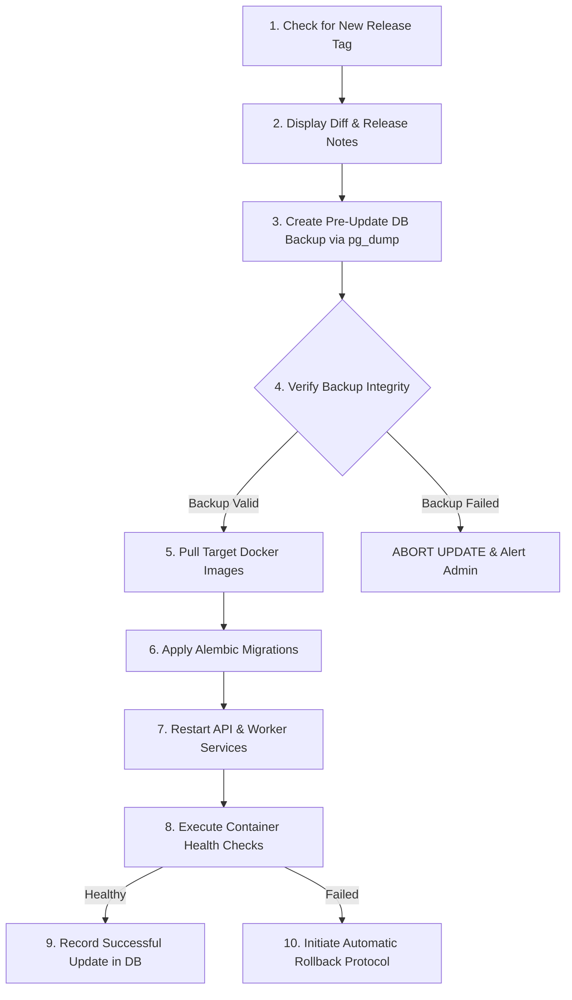

# UPDATE & LIFECYCLE MANAGEMENT: Single Organization Edition

## 1. Centralized Version Management & SemVer Strategy
The WhatsApp AI Agent platform strictly adheres to **Semantic Versioning (SemVer 2.0.0)**:
- **MAJOR (`X.0.0`)**: Breaking database changes, fundamental architectural shifts, or major framework upgrades.
- **MINOR (`1.X.0`)**: Backwards-compatible new features, new agent tools, or new UI dashboards.
- **PATCH (`1.0.X`)**: Backwards-compatible bug fixes, security patches, or LLM prompt refinements.

### Centralized Version Manifest (`version.json`)
Located at the root of the project:
```json
{
  "version": "1.0.0",
  "build_date": "2026-11-13",
  "min_compatible_db_version": "1.0.0",
  "release_notes_url": "https://github.com/organization/physio-one-agent/releases/tag/v1.0.0",
  "schema_version": 1
}
```

---

## 2. Inviolable Data Protection Rules

During any software update, upgrade, or rollback:
1. **NEVER DELETE CONVERSATIONS**: Existing WhatsApp conversations and messages must remain intact.
2. **NEVER DELETE PATIENT RECORDS**: Patient profiles, contact mappings, and consent flags are permanent clinical assets.
3. **NEVER DELETE CAMPAIGN HISTORY**: Historical campaign broadcasts and conversion metrics must persist.
4. **NEVER RESET USER ACCOUNTS**: Staff passwords and roles must survive migrations unchanged.
5. **NEVER OVERWRITE CONFIGURATION**: Production `.env` files and clinic settings must never be replaced by defaults.
6. **NEVER RESET POSTGRES VOLUMES**: Docker persistent volumes (`postgres_data`) must never be purged.
7. **NEVER DROP USER DATA COLUMNS**: Do not perform destructive SQL `DROP COLUMN` on columns with active user data.

---

## 3. Database Migration Strategy: Expand-and-Contract

To guarantee zero downtime and safe rollbacks, all Alembic database migrations must use the **Expand-and-Contract** methodology:

```
Phase 1 (Current): Version 1.0.0 uses column `old_col`.
Phase 2 (Expand):  Version 1.1.0 adds `new_col` nullable. Both written.
Phase 3 (Migrate): Backfill script copies data from `old_col` to `new_col`.
Phase 4 (Contract): Next major release removes `old_col` only after verification.
```

- **Forward-Compatible Schema**: Every migration must be forward-compatible with the immediately preceding application version.
- **No Automatic Downgrades**: Database down-migrations are disabled automatically in production to prevent accidental loss of freshly written data.

---

## 4. Automated 10-Step Update Pipeline

When an update is initiated from the UI or via `scripts/update.sh`:



### Detailed Pipeline Steps:
1. **Probe Remote Release**: Queries the version endpoint/registry for newer tags.
2. **Display Changelog**: Displays release notes and any operator intervention requirements.
3. **Automated Database Snapshot**: Runs `scripts/backup.sh` generating an encrypted timestamped dump in `/backups/pre-upgrade-vX.Y.Z-<timestamp>.sql.gz`.
4. **Backup Verification**: Verifies the backup archive size (> 0 bytes) and gzip integrity before proceeding.
5. **Image Pulling**: Pulls version-tagged Docker images (e.g. `physio-one-api:v1.1.0`).
6. **Execute Migrations**: Runs `alembic upgrade head` inside the API container.
7. **Service Rolling Restart**: Restarts `worker`, `scheduler`, and `api` sequentially.
8. **Automated Health Checks**: Pings `/api/v1/health` and verifies Celery worker responsiveness.
9. **Log Success**: Updates `system_settings` with new version string and timestamp.
10. **Automated Rollback (On Failure)**: If health checks fail within 120 seconds, the update runner automatically:
    - Stops the new containers.
    - Reverts the Docker tag to the previous version.
    - Restarts the previous stable containers.
    - Preserves the database and alerts the Super Admin.

---

## 5. Upgrade & Disaster Recovery Scripts

- `scripts/backup.sh`: Standalone script for one-command PostgreSQL and media backups.
- `scripts/restore.sh`: Interactive or headless point-in-time database restore script.
- `scripts/update.sh`: Host-level automated update orchestrator.
- `scripts/healthcheck.sh`: Comprehensive sanity check of all 6 containers, database connectivity, and Redis latency.

---

## 6. Cloud Run Revision Strategy for Staging & Production
In Google Cloud Run environments:
- Service deployments create immutable, versioned Revisions (e.g. `physio-staging-api-00002-abc`).
- Zero-downtime rolling traffic shift: traffic shifts to the new revision only after container startup probes (`/health`) pass.
- Instant rollback: traffic can be routed back to the prior stable revision in under 5 seconds via `gcloud run services update-traffic --to-revisions=PREV_REV=100`.
- Bounded workers execute via Cloud Run Jobs (`physio-staging-worker-once`) without running persistent idle containers.

